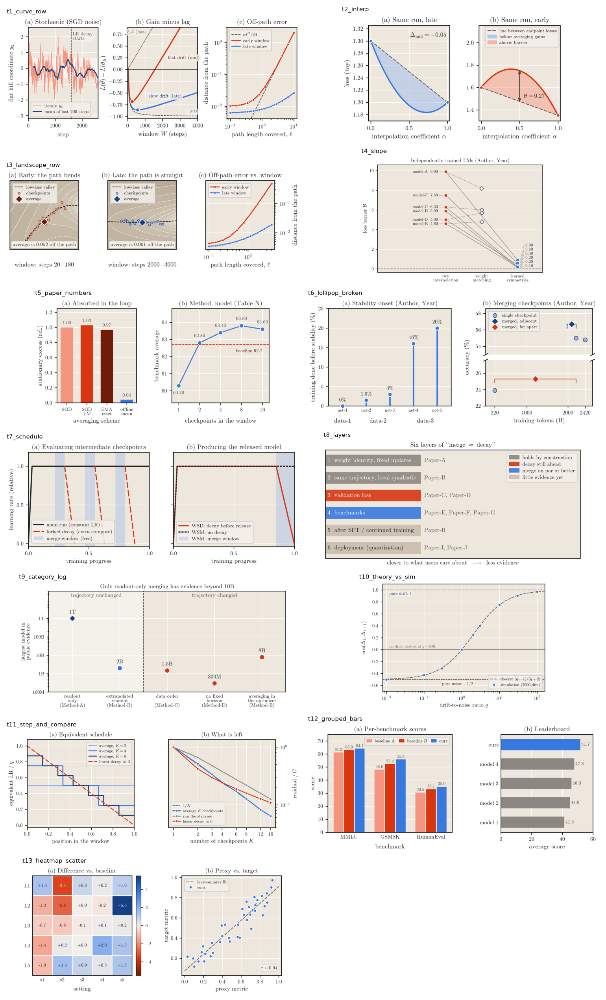

# research-figures

A Claude Code / Agent skill for publication-quality matplotlib figures in ML papers and technical blogs. It has one fixed house style: tinted panels, a white grid, Computer Modern text, red/blue semantic colour families and strict row alignment. It also ships 13 runnable templates.



## What's inside

| Path | What |
|---|---|
| `SKILL.md` | The rules the agent follows: how to read the context, pick a chart, set sizes and colours, align rows, write captions, and a final checklist |
| `figkit/style.py` | The style module: `apply()`, palettes, `align_xlabels`, `check_row`, `tint_cmap`, `diverging_cmap`, annotation helpers and venue widths |
| `templates/t0…t13` | A skeleton plus 13 runnable figure patterns on synthetic data |
| `templates/make_gallery.py` | Runs every template and rebuilds the gallery |
| `references/diagrams.md` | Schematics: matplotlib, TikZ, Mermaid and six-part Gemini prompts with style blocks |

## Install

```bash
# Claude Code (personal skills)
git clone https://github.com/euyis1019/research-figures ~/.claude/skills/research-figures
# or per project
git clone https://github.com/euyis1019/research-figures .claude/skills/research-figures
```

The agent then uses the skill whenever you ask for a paper or blog figure. To use the style without an agent:

```python
import sys; sys.path.insert(0, "path/to/research-figures/figkit")
import style; style.apply()            # "warm" (default) or "cool"
from style import REDS, BLUES, INK, INK2, GRAY, FULL_W
```

Requirements: Python 3.9+, matplotlib ≥ 3.7 and numpy. LaTeX is not needed. To regenerate the gallery, run `python3 templates/make_gallery.py [warm|cool]`.

## Style references

The look follows the figures in Hägele et al. 2024, *Scaling Laws and Compute-Optimal Training Beyond Fixed Training Durations* (arXiv 2405.18392), and Song et al. 2025, *Through the River* (arXiv 2507.09846).

## License

MIT. Parts of `references/diagrams.md` and the chart-selection guidance are adapted from Orchestra Research's `academic-plotting` skill (MIT); see `THIRD_PARTY_NOTICES.md`.
