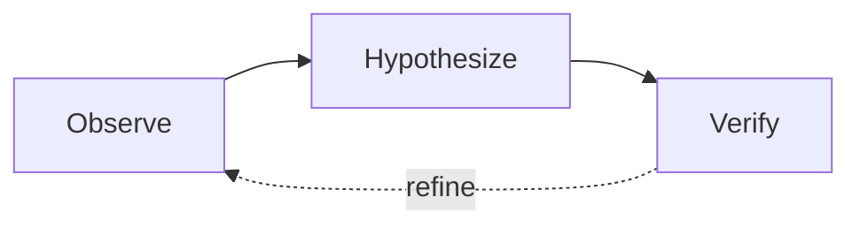

# 示意图：架构、流程、框图

按确定性从高到低选工具，能用前一个就不用后一个：

| 工具 | 适用 | 说明 |
|---|---|---|
| matplotlib（T7、T8） | 调度、分层、状态条、窗口 | 与数据图同一套样式，可复现，首选 |
| TikZ | 十个框以内、关系清楚的结构图 | 在 LaTeX 里原生渲染，字体与正文一致 |
| Mermaid | 先画草图核对逻辑 | 逻辑确认之后再决定最终用什么画 |
| Gemini 图像生成 | 复杂的架构图、带图标的总览图 | 输出不确定，必须写完整提示词、生成 3 次挑最好的 |

无论用哪种工具，颜色都沿用本 skill 的语义（`style.py` §4）：主体和收益用蓝，失败和基线用红，次要用灰，底色用 warm 米色。

## 1. 从上下文抽结构

1. **实体**：找表示系统部件的名词（模块、阶段、层），并数清楚有几个。超过 8 个顶层实体时，先分组。
2. **关系**：找表示流向的动词（“送给”“查询”“反馈”），分成三类：数据流（实线）、控制流（灰实线）、失败或重试（红虚线）。
3. **布局**：顺序流程用左→右；分层结构用横带竖叠；有中心组件用辐射；层级决策用自上而下的树。
4. **文字**：每个标签都从正文原样抄过来，不改写、不缩写。

## 2. TikZ（使用本 skill 的配色）

```latex
\definecolor{fBlue}{HTML}{3879E0}  \definecolor{fBlueL}{HTML}{91B4EE}
\definecolor{fRed}{HTML}{D83611}   \definecolor{fInk}{HTML}{262626}
\definecolor{fInk2}{HTML}{5A5650}  \definecolor{fFace}{HTML}{EEE7DD}
\begin{tikzpicture}[
    box/.style={draw=#1, fill=fFace, rounded corners=4pt, minimum width=2.6cm,
                minimum height=0.9cm, font=\small, line width=0.8pt, text=fInk},
    lbl/.style={font=\scriptsize\itshape, text=#1},
    arr/.style={-{Stealth[length=5pt]}, line width=0.8pt, color=#1},
]
  \node[box=fInk]  (a) at (0,0) {Planner};
  \node[box=fInk]  (b) at (4,0) {Executor};
  \node[box=fBlue] (c) at (8,0) {Verifier};
  \draw[arr=fInk2] (a) -- (b) node[midway, above, lbl=fInk2] {task plan};
  \draw[arr=fInk2] (b) -- (c) node[midway, above, lbl=fInk2] {results};
  \draw[arr=fRed, dashed] (c) to[bend left=30] node[midway, below, lbl=fRed] {revise} (a);
\end{tikzpicture}
```

## 3. Mermaid 草图



## 4. Gemini 图像生成

### 4.1 提示词的六段结构

每个提示词按顺序包含这六段。提示词写得越具体，出图越稳：泛泛的提示只会得到千篇一律的企业流程图。

1. **定调**（5–10 行）：给哪个 venue、什么风格、要给人什么感觉。
2. **视觉风格**（20–40 行）：从下面 4.2 节整段复制一个风格块，再补细节。这是最重要的一段。写质感，不只写几何，比如写“像粗头马克笔画在光滑纸上，线条轻微抖动”，而不是“线条稍不规则”。
3. **配色**（10–15 行）：每种颜色都给出准确的 hex 码，写明“只用这些颜色，不得替换”。
4. **布局**（50–150 行）：每个框写出准确文字和副标题，明确空间关系（如“A 在 B 的左边”）、分组（如“这三个框在标为 X 的区域里”）和相对尺寸（如“宽高约 2:1”）。
5. **连线**（30–80 行）：逐条写，模板如下：
   ```
   ARROW [N]: [Source] → [Target]
   - Style: solid / dashed / dotted      - Color: #hex      - Weight: 1px / 2px / 3px
   - Routing: straight / curves UP / curves DOWN / around X
   - Label: "[text]" italic, above / below
   - Arrowhead: filled triangle / open chevron / dot
   ```
6. **约束**（10–15 行）：不要什么。至少包括：没有图号、图注、水印；每个标签按原文逐字拼写；不要 clip art、emoji、照片元素。

### 4.2 风格块

整篇论文只选一种风格，所有示意图保持一致。

**H · House（默认，与本 skill 的数据图配套）**
```
VISUAL STYLE — HOUSE:
- Flat, precise academic diagram on a pure white background
- Sections are rounded rectangles (6px radius) filled with warm paper tint #EEE7DD, no border
- Component boxes: white fill, 1px border #262626, 4px rounded corners, labels inside
- Main path and the paper's own method in blue: #3879E0 (light fill #91B4EE for emphasis)
- Baselines, failure or retry paths in red #D83611, dashed
- Secondary text and arrows in warm gray #5A5650; primary text #262626
- Serif text resembling Computer Modern (LaTeX default font); titles regular weight, not bold
- Arrows 1.2px, filled small triangle heads; no shadows, no gradients, no icons
```

**A · 简笔画（Hand-drawn sketch）**
```
VISUAL STYLE — HAND-DRAWN SKETCH:
- Slightly irregular hand-drawn lines, like a thick felt-tip marker; wobbly but legible
- Warm off-white background #FAFAF7; soft watercolor-like washes:
  blue #D6E4F0, wheat #F5DEB3, sage #D4E6D4, lavender #E6DFF0
- Charcoal #2C2C2C borders 2–3px, slightly uneven; open hand-drawn arrowheads
- Small line-art doodle icons inside boxes (gear, lightbulb, magnifier) — NOT emoji, NOT clip art
- Rounded sans-serif text; overall a carefully drawn whiteboard, publication quality
```

**B · Modern Minimal**
```
VISUAL STYLE — MODERN MINIMAL:
- Crisp geometric shapes; desaturated section fills: slate #E8EDF2, sand #F5F0E8, mint #E8F2EE
- Boxes: 12px rounded corners, no border, float with a barely visible shadow (1px, 4px blur, 6% black)
- One accent per section, used sparingly: #2563EB, #059669, #D97706, #E11D48
- Thin 1.5px gray #6B7280 arrows, small dot at source, clean chevron at target
- Sans-serif; labels inside boxes; at least 24px whitespace between elements; no icons
```

**C · Illustrated Technical**
```
VISUAL STYLE — ILLUSTRATED TECHNICAL:
- Each component has a small meaningful line-art icon (single colour, 2px stroke, ~24px)
- Rounded rectangles with a 4px coloured LEFT strip; faint group tints behind related parts
- Curved bezier connections coloured by their source; main flows 3px, secondary 1px dashed
- Small badges on arrows ("×N", "optional"); section titles in small caps above each group
```

**D · Classic Accent Bar**
```
VISUAL STYLE — CLASSIC ACCENT BAR:
- Horizontal section bands stacked vertically, pale gray #F7F7F5 fill, 8px coloured left bar
- Content boxes: white fill, thin #DDDDDD border, 4px corners
- Section palette: blue #4A90D9, teal #5BA58B, amber #D4A252, slate #7B8794
- Arrows coloured by their source section; flat, zero decoration; works in grayscale
```

### 4.3 生成脚本

脚本保存为 `figures/gen_fig_<name>.py`。API key 只从环境变量读取，不写进脚本。

```python
#!/usr/bin/env python3
"""Generate <name> diagram with Gemini; 3 attempts, pick the best by hand."""
import os, sys, time
from google import genai                                  # pip install google-genai

API_KEY = os.environ.get("GEMINI_API_KEY")
if not API_KEY:
    sys.exit("Set GEMINI_API_KEY (https://aistudio.google.com/apikey)")
MODEL = "gemini-3-pro-image-preview"
OUT = os.path.dirname(os.path.abspath(__file__))
client = genai.Client(api_key=API_KEY)

PROMPT = """
[六段提示词]
"""

def generate(i):
    r = client.models.generate_content(
        model=MODEL, contents=PROMPT,
        config=genai.types.GenerateContentConfig(response_modalities=["IMAGE", "TEXT"]))
    for part in r.candidates[0].content.parts:
        if part.inline_data:
            path = os.path.join(OUT, f"fig_NAME_attempt{i}.png")
            open(path, "wb").write(part.inline_data.data)
            return path
        if part.text:
            print(part.text[:300])

paths = []
for i in (1, 2, 3):
    if i > 1:
        time.sleep(2)
    p = generate(i)
    if p:
        paths.append(p); print("saved", p)
if not paths:
    sys.exit("all attempts failed")
```

### 4.4 三次结果怎么挑

每次结果按下面 5 项各打 1–5 分，加权求和：

| 维度 | 看什么 | 权重 |
|---|---|---|
| 风格一致 | 是否是要求的风格 | 30% |
| 文字准确 | 拼写正确，没有多出来的文字 | 25% |
| 布局一致 | 空间关系与提示词相符 | 20% |
| 颜色准确 | hex 码对得上，前后一致 | 15% |
| 连线准确 | 箭头齐全，走向和标签正确 | 10% |

常见问题的修法：
- 风格跑偏：给风格块补更多质感描写，并加一句 "The overall aesthetic should resemble [具体参照]"。
- 文字错误：加 `CRITICAL: The word "[原词]" must appear EXACTLY. Do not abbreviate or change capitalization.`
- 布局不对：给出坐标或网格位置，如 "Box A at (left 10%, top 20%)"。
